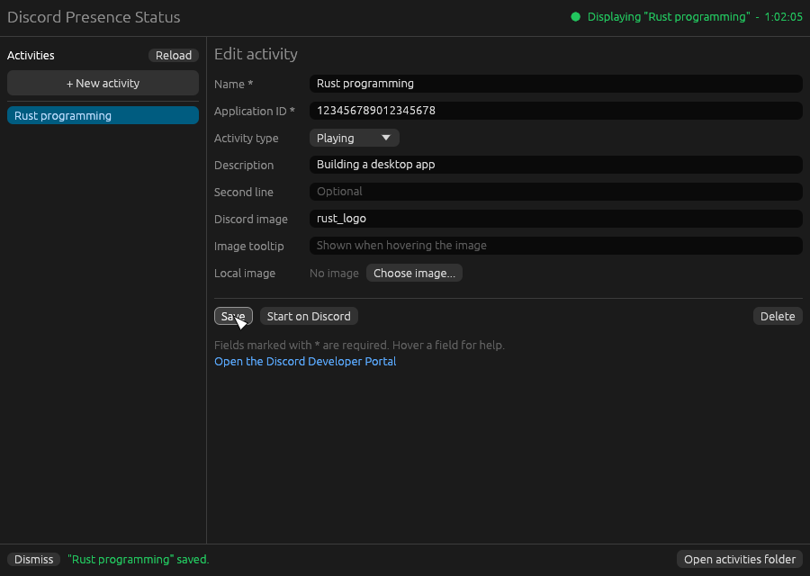

# Discord Presence Status

[](https://github.com/Yatsuuw/discord_presence_status/actions/workflows/ci.yml)
[](https://github.com/Yatsuuw/discord_presence_status/releases)
[](LICENSE)

A very lightweight Windows application to show **your own custom activity** on your
Discord profile — with a name, a description, an image and Discord's elapsed timer.



## Features

- **Your own activities** — create as many as you like, each with a name, a
  description, a second line, an image and an activity type
  (Playing, Listening to, Watching, Competing in).
- **Discord timer** — the "elapsed" counter starts when you start an activity
  and keeps running while you edit it.
- **Stored locally** — every activity lives in its own folder,
  `user_activity/<name>/activity.toml`, next to its optional image. Nothing is
  sent anywhere except to the Discord app running on your computer.
- **Resilient** — start Discord after the application, or restart it: the
  activity comes back automatically.
- **Runs in the system tray** — while an activity is displayed, closing the
  window hides it to the notification area; start, stop or quit from the tray
  icon menu.
- **Light** — a single ~5 MB native executable, no runtime to install.
- **Installed like a real application** — for your account only (no
  administrator rights) or for every user of the computer.

## Installation

Download the latest version from the
[Releases page](https://github.com/Yatsuuw/discord_presence_status/releases):

| File | When to use it |
|------|----------------|
| `DiscordPresenceStatus-<version>-setup-x64.exe` | Recommended. The installer asks whether to install for you only or for all users. |
| `DiscordPresenceStatus-<version>-portable-x64.zip` | No installation: unzip anywhere and run. |

See [docs/INSTALLATION.md](docs/INSTALLATION.md) for details, silent
installation and how to verify your download.

> **Windows SmartScreen** may warn that the application is from an unknown
> publisher, because the executable is not code-signed. Choose *More info* →
> *Run anyway*. You can verify that a file really comes from this repository
> with its [build attestation](docs/INSTALLATION.md#verifying-a-download).

## Quick start

1. Create an application in the
   [Discord Developer Portal](https://discord.com/developers/applications)
   and copy its **Application ID**.
2. Open Discord Presence Status, click **+ New activity**, fill in the name,
   the Application ID and the description.
3. Click **Start on Discord**. Your profile now shows the activity.

The full walkthrough, including how to add images, is in the
[user guide](docs/USER_GUIDE.md).

## Building from source

Requirements: [Rust](https://rustup.rs) 1.95 or newer and the
*Desktop development with C++* workload of Visual Studio Build Tools.

```powershell
git clone https://github.com/Yatsuuw/discord_presence_status.git
cd discord_presence_status
cargo run --release
```

To build the installer as well, install [Inno Setup 6](https://jrsoftware.org/isinfo.php) and run:

```powershell
cargo build --release
./scripts/build-installer.ps1
```

## Documentation

| Document | Content |
|----------|---------|
| [User guide](docs/USER_GUIDE.md) | Creating a Discord application and your activities. |
| [Installation](docs/INSTALLATION.md) | Installation modes, data location, uninstallation. |
| [Architecture](docs/ARCHITECTURE.md) | How the code is organised, for contributors. |
| [Releasing](docs/RELEASING.md) | How a new version is published. |
| [GitHub setup](docs/GITHUB_SETUP.md) | Recommended settings for this public repository. |
| [Contributing](CONTRIBUTING.md) | How to propose a change. |
| [Security](SECURITY.md) | How to report a vulnerability. |

## License

[MIT](LICENSE). This project is not affiliated with or endorsed by Discord Inc.
